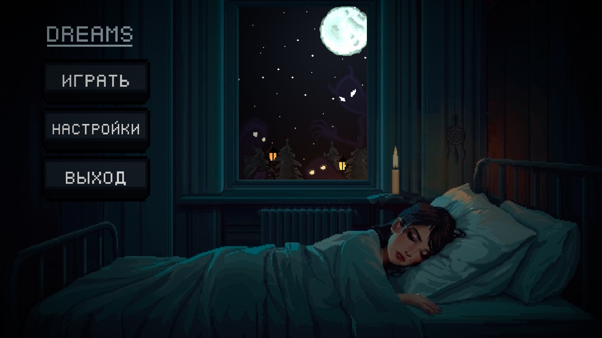
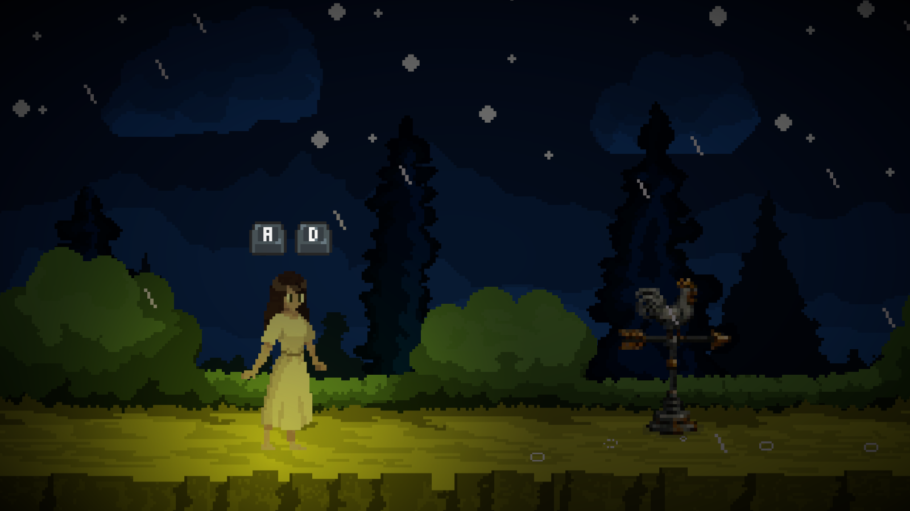
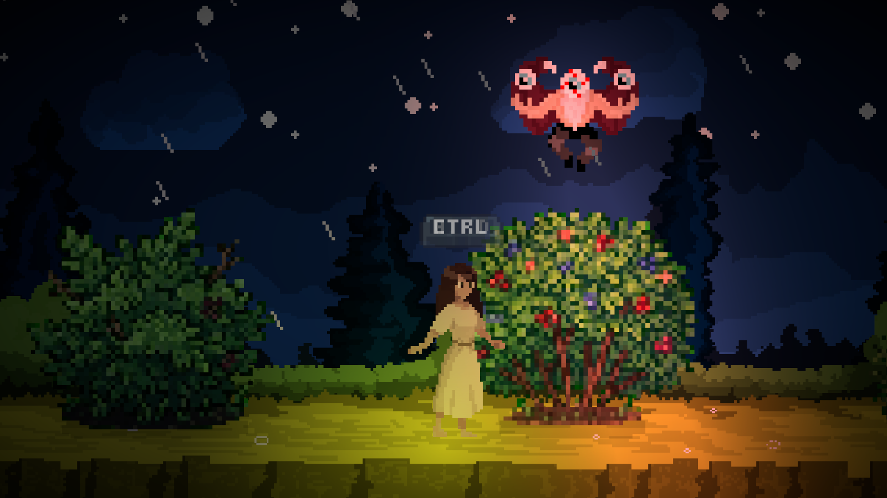
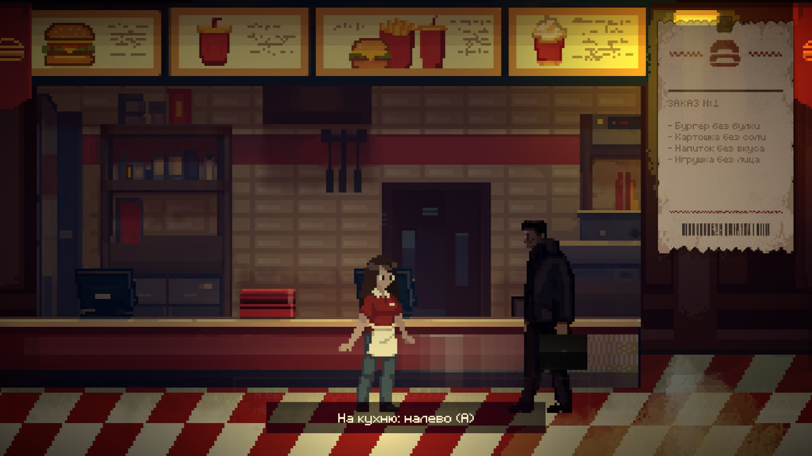
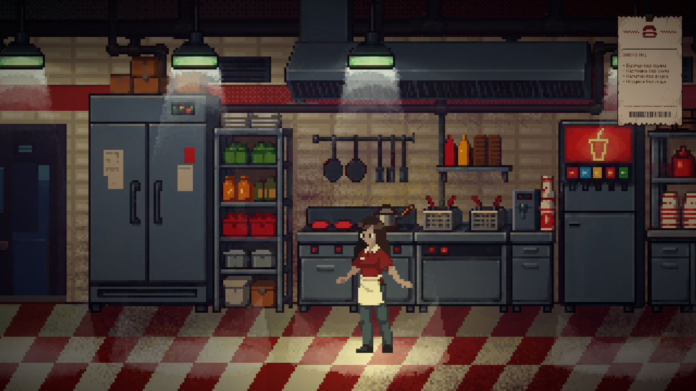
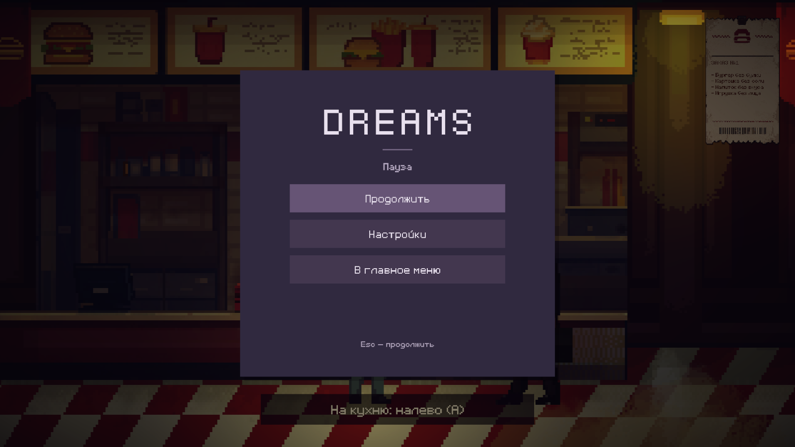
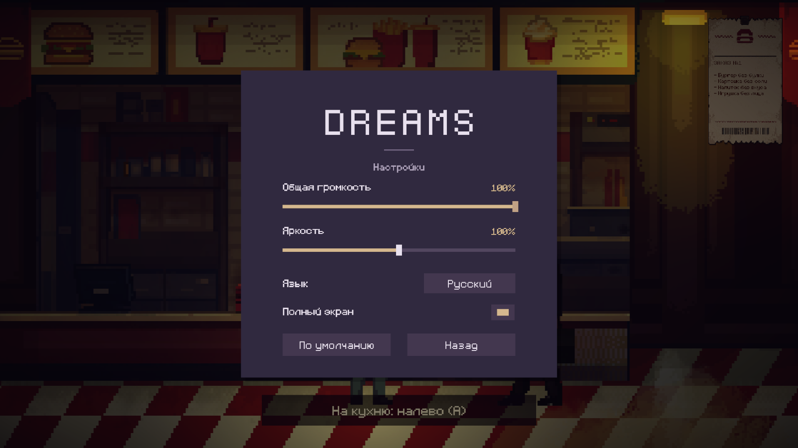

# DREAMS


**Ночное поле. Незнакомый посетитель. Смена, которая становится всё страннее.**

DREAMS — атмосферная 2D-игра о снах Евы: платформинг, скрытность и сюжетные сцены с пиксельной графикой. В одном сне нужно следовать за зайцем и прятаться от Глаза, в другом — надеть форму фастфуда, выслушать администратора и принять первый заказ от мужчины без лица.



## Локации

### Ночное поле · NightField

Дождь, тёмные деревья и заяц, указывающий путь. Ева преодолевает препятствия, читает записки и ищет укрытия. Летающий Глаз осматривает дорогу лучом прожектора: попадание в луч приводит к гибели и возвращению к чекпоинту.

| Первые шаги | Под наблюдением |
| :---: | :---: |
|  |  |
| Знакомство с движением и окружением. | Укрытия помогают пройти опасные участки. |

### Фастфуд · FastFood

Ева просыпается перед началом смены. Администратор подходит к ней, затем проводит инструктаж у кассы. Первый посетитель — мужчина без лица — оставляет необычный заказ. На экране появляется чек, а подсказка направляет Еву налево, на кухню.

| Касса и первый заказ | Кухня |
| :---: | :---: |
|  |  |
| Чек остаётся под рукой и раскрывается при наведении курсора. | Камера следует за Евой, свет ламп синхронизирован с их мерцанием. |

Между залом и кухней можно перемещаться через плавное затемнение экрана. Чтобы вернуться к кассе, нужно дойти до правого края кухни.

## Игровые механики

- **Движение и платформинг:** ходьба, бег, прыжки и замедление шага.
- **Скрытность:** укрытия от прожектора Глаза, гибель и возрождение у чекпоинтов.
- **Исследование:** погоня за зайцем, интерактивные предметы и записки.
- **Диалоги:** вступительные сцены, персонажи и посимвольное появление реплик.
- **Работа у кассы:** инструктаж, посетитель и заказ на чеке. Через несколько секунд чек уменьшается; при наведении плавно разворачивается.
- **Атмосфера:** параллакс, динамическая камера, локальный 2D-свет, мерцание ламп, звуки шагов и окружения.
- **Два языка:** русский и английский; смена языка обновляет и уже полученный заказ.

## Пауза и настройки

`Esc` открывает меню паузы: можно продолжить игру, перейти к настройкам или вернуться в главное меню. Курсор остаётся видимым во время игры.

| Меню паузы | Настройки |
| :---: | :---: |
|  |  |

Доступны общая громкость, яркость, русский или английский язык, полноэкранный режим и сброс настроек. Выбранные параметры сохраняются между запусками.

## Управление

| Клавиша | Действие |
| --- | --- |
| `A` / `D`, `←` / `→` | Движение |
| `Space` | Прыжок |
| `Left Shift` | Бег |
| `Left Ctrl` | Медленный шаг; удерживать в укрытии, чтобы спрятаться |
| `E` | Взаимодействие; допечатать реплику, перейти к следующей или закрыть записку |
| `Esc` | Пауза; назад из настроек; продолжить игру |
| Наведение курсора на чек | Развернуть заказ |

## Запуск в Unity

1. Установите Unity Hub и редактор **Unity 6000.2.4f1**.
2. Клонируйте репозиторий:

   ```bash
   git clone https://github.com/plrtp68217/dreams.git
   ```

3. В Unity Hub выберите **Add → Add project from disk** и укажите папку `dreams`.
4. Дождитесь импорта ресурсов и восстановления пакетов.
5. Откройте `Assets/Scenes/MainMenu.unity` и нажмите **Play**. Кнопка «Играть» запускает `NightField`.

Для просмотра фастфуда остановите Play Mode, откройте `Assets/Scenes/FastFood.unity` и снова нажмите **Play**. Эта сцена пока запускается отдельно и не включена в общий список сцен сборки.

## Технологии и структура

- **Unity 6 · 6000.2.4f1**, **C#**.
- **Universal Render Pipeline 17.2** и 2D-освещение.
- **Cinemachine 3.1** — следование камеры и ограничение её движения.
- **uGUI и TextMeshPro** — меню, подсказки, диалоги и чек.
- **Aseprite Importer** — импорт пиксельной графики и покадровой анимации.
- Собственная система локализации диалогов с данными в JSON.

| Папка | Содержимое |
| --- | --- |
| `Assets/Scenes/` | Главное меню, ночное поле и фастфуд |
| `Assets/Scripts/Implementations/` | Игрок, заяц, враги и NPC |
| `Assets/Scripts/Services/` | Ввод, движение, звук, чекпоинты и настройки |
| `Assets/Scripts/DialogSystem/` | Диалоги, взаимодействия и локализация |
| `Assets/Scripts/Till/` | Касса, заказ посетителя и переходы на кухню |
| `Assets/Scripts/Camera/`, `Assets/Scripts/Light/`, `Assets/Scripts/UI/` | Камера, свет и интерфейс |
| `Assets/Sprites/`, `Assets/Animations/` | Графика и анимации |
| `docs/screenshots/` | Скриншоты из игры для этого README |

## Состояние проекта

Игра находится в активной разработке. В репозитории доступны игровая сцена `NightField` и развивающаяся сюжетная сцена `FastFood` с кассой и кухней. Задачи, идеи и замечания бета-теста v0.0.1 собраны в [TODO.md](TODO.md).

Все скриншоты сняты в Play Mode в Unity и показывают текущее состояние проекта.
