# DREAMS — библиотека VFX заброшенного фастфуда

Утверждённые тесты steam_small и stove_fire сохранены побайтово. Новые эффекты добавлены после подтверждения пользователя.

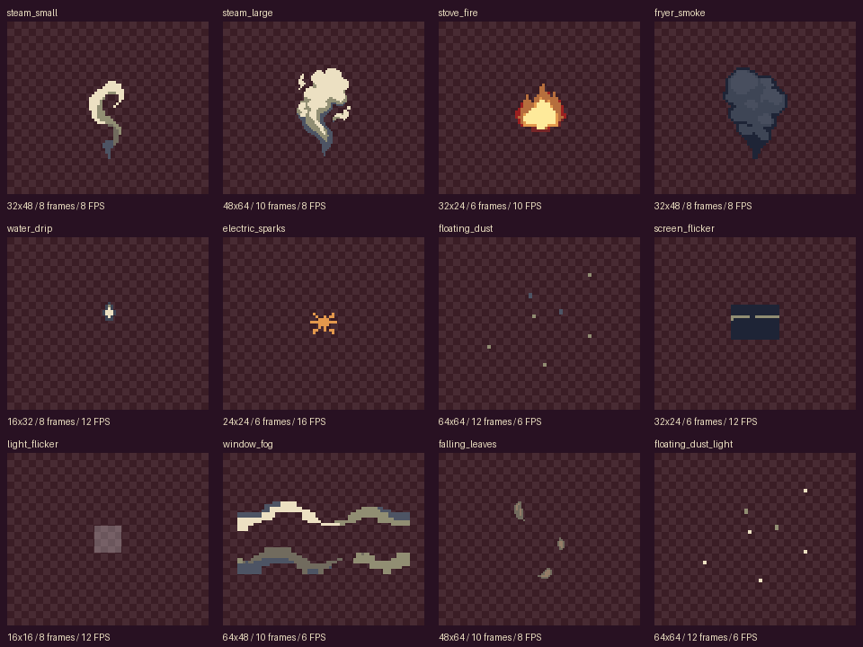

| Эффект | Размер кадра | Кадры | FPS | Воспроизведение |
|---|---|---|---|---|
| [steam_small](steam_small/prompt.md) | 32×48 | 8 | 8 | Цикл |
| [steam_large](steam_large/prompt.md) | 48×64 | 10 | 8 | Цикл |
| [stove_fire](stove_fire/prompt.md) | 32×24 | 6 | 10 | Цикл |
| [fryer_smoke](fryer_smoke/prompt.md) | 32×48 | 8 | 8 | Цикл |
| [water_drip](water_drip/prompt.md) | 16×32 | 8 | 12 | Один раз, пауза 0.5–1.5 с |
| [electric_sparks](electric_sparks/prompt.md) | 24×24 | 6 | 16 | Один раз, пауза 0.5–1.5 с |
| [floating_dust](floating_dust/prompt.md) | 64×64 | 12 | 6 | Цикл |
| [screen_flicker](screen_flicker/prompt.md) | 32×24 | 6 | 12 | Цикл |
| [light_flicker](light_flicker/prompt.md) | 16×16 | 8 | 12 | Цикл |
| [window_fog](window_fog/prompt.md) | 64×48 | 10 | 6 | Цикл |
| [falling_leaves](falling_leaves/prompt.md) | 48×64 | 10 | 8 | Один проход вниз |
| [floating_dust_light](floating_dust_light/prompt.md) | 64×64 | 12 | 6 | Цикл |

Размеры и число кадров совпадают с запросом. Для light_flicker, где параметры не были заданы, выбран холст 16×16 и 8 кадров. В каждом spritesheet одна последовательная горизонтальная строка без отступов. Не создавались дублирующие или интерполированные кадры для заполнения последовательностей.

PNG-кадры и spritesheet прозрачные. Все эффекты, кроме технической маски лампы, имеют бинарную альфу 0/255; общая прозрачность задаётся при будущем ручном использовании, рекомендуемые значения — в prompt.md. Маска лампы использует один белый RGB-цвет и однородную меняющуюся альфу на неподвижном контуре: яркость извлечена из сгенерированной API последовательности, отдельного режима ламп у PixelLab нет. Нет нарисованного света или пространственного градиента.

При генерации светлой пыли PixelLab удалил все частицы как фон. Исходные пустые варианты оставлены в Temp; стартовое расположение взято из тусклой пыли и переведено в светлую палитру. Движение светлой пыли сгенерировано отдельным запросом, её кадры не копировались из тусклой версии.

GIF показывает исходный масштаб в окне 320×180 и увеличение Nearest Neighbor; шахматный фон существует только в превью. В GIF капли и искр добавлено время ожидания последнего состояния, без дополнительных PNG-кадров.

## Технические поправки и ограничения

- Пыль анимирована API на временном одноцветном фоне #281122, который удалён по цвету при экспорте: автоматическое удаление фона стирало частицы. Разреженные формы частиц из API распределены по холсту до анимации.
- Собственная анимация тусклой пыли исчезала в середине цикла. Итоговая тусклая версия — перевод стабильной светлой последовательности в серую палитру, поэтому два вида пыли имеют одинаковое движение. Неудачные попытки сохранены; за полностью пустые анимации API сообщил отсутствие списания.
- Основание большого пара и дыма закреплено целочисленными сдвигами кадров.
- Листья — один проход вниз, не бесшовный цикл. Вращения и формы получены из API; отдельные листья целочисленно перемещены по нисходящим траекториям, поскольку модель возвращала их вверх даже без конечного кадра. Ни один пиксель листа не перерисован и не интерполирован.
- При отклонении цвета от палитры он приведён к ближайшему допустимому цвету без дизеринга.
- Повторяющиеся состояния экрана, пустые окончания капли и искр пришли из API: это удержания, не добавленные копированием недостающие кадры. GIF может объединять такие состояния с сохранением их длительности; PNG-последовательность сохраняет заданное число кадров.

## steam_small

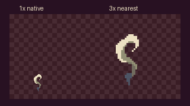

[Кадры](steam_small/frames/) · [Spritesheet](steam_small/spritesheet.png) · [Промпт и настройки](steam_small/prompt.md) · [Все кадры](steam_small/contact.png)

## steam_large

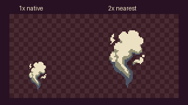

[Кадры](steam_large/frames/) · [Spritesheet](steam_large/spritesheet.png) · [Промпт и настройки](steam_large/prompt.md) · [Все кадры](steam_large/contact.png)

## stove_fire

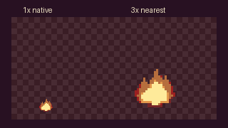

[Кадры](stove_fire/frames/) · [Spritesheet](stove_fire/spritesheet.png) · [Промпт и настройки](stove_fire/prompt.md) · [Все кадры](stove_fire/contact.png)

## fryer_smoke

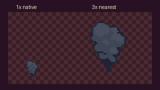

[Кадры](fryer_smoke/frames/) · [Spritesheet](fryer_smoke/spritesheet.png) · [Промпт и настройки](fryer_smoke/prompt.md) · [Все кадры](fryer_smoke/contact.png)

## water_drip

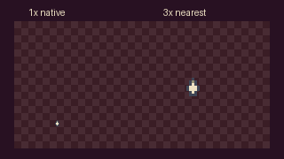

[Кадры](water_drip/frames/) · [Spritesheet](water_drip/spritesheet.png) · [Промпт и настройки](water_drip/prompt.md) · [Все кадры](water_drip/contact.png)

## electric_sparks

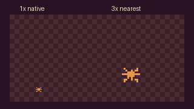

[Кадры](electric_sparks/frames/) · [Spritesheet](electric_sparks/spritesheet.png) · [Промпт и настройки](electric_sparks/prompt.md) · [Все кадры](electric_sparks/contact.png)

## floating_dust

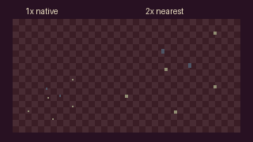

[Кадры](floating_dust/frames/) · [Spritesheet](floating_dust/spritesheet.png) · [Промпт и настройки](floating_dust/prompt.md) · [Все кадры](floating_dust/contact.png)

## screen_flicker

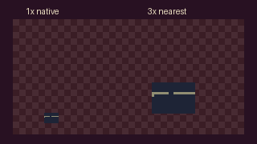

[Кадры](screen_flicker/frames/) · [Spritesheet](screen_flicker/spritesheet.png) · [Промпт и настройки](screen_flicker/prompt.md) · [Все кадры](screen_flicker/contact.png)

## light_flicker

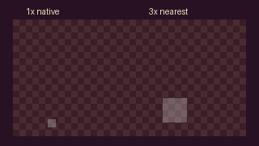

[Кадры](light_flicker/frames/) · [Spritesheet](light_flicker/spritesheet.png) · [Промпт и настройки](light_flicker/prompt.md) · [Все кадры](light_flicker/contact.png)

## window_fog

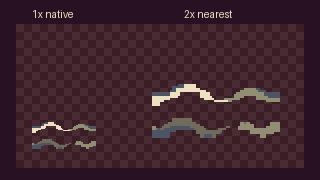

[Кадры](window_fog/frames/) · [Spritesheet](window_fog/spritesheet.png) · [Промпт и настройки](window_fog/prompt.md) · [Все кадры](window_fog/contact.png)

## falling_leaves

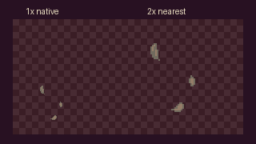

[Кадры](falling_leaves/frames/) · [Spritesheet](falling_leaves/spritesheet.png) · [Промпт и настройки](falling_leaves/prompt.md) · [Все кадры](falling_leaves/contact.png)

## floating_dust_light

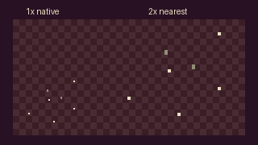

[Кадры](floating_dust_light/frames/) · [Spritesheet](floating_dust_light/spritesheet.png) · [Промпт и настройки](floating_dust_light/prompt.md) · [Все кадры](floating_dust_light/contact.png)

## Проверки

Проверены размеры, число кадров, палитры, альфа, отсутствие полностью статичных последовательностей, точное восстановление кадров из spritesheet и временные параметры GIF. Для циклов измерено отличие последнего кадра от первого относительно внутренних переходов; для эмиттеров проверено положение основания. В исходных ответах и Temp сохранены все варианты, включая неудачные. Метрики и SHA-256 — Temp/library-validation.json.

Суммарный денежный эквивалент по ответам API, включая исходные два теста и уточнение малого пара: около $1.369. Оплата может идти поколениями тарифного плана; billing_usage сохранены в Temp/costs.json.

Unity-сцены, GameObject, материалы, настройки и прежние ассеты не изменялись. Импорт и коммиты не выполнялись.
