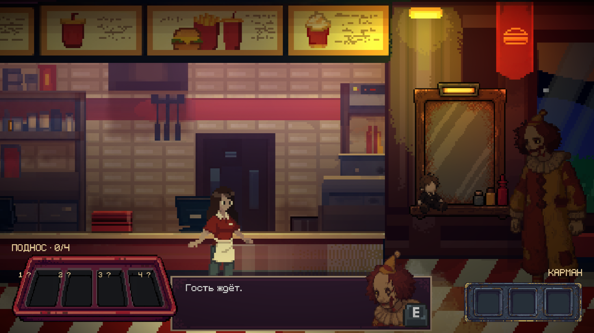

# Клоун во время заказа мужчины без лица

Клоун работает как наблюдатель: три сюжетных повода и одно дополнительное напоминание при отсутствии прогресса. Прежний бесконечный таймер визитов и надпись «Напряжение 1/3» отключены. У клоуна нет коллайдера, урона или механики погони.

## Появления

| Повод | Поведение |
| --- | --- |
| Заказ получен, Ева вышла из-за кассы | Молчаливое наблюдение у столиков; управление остаётся у игрока |
| Первое возвращение с кухни с бургером, картошкой или напитком | Клоун ближе к Еве: «Гость ждёт» |
| Собраны четыре предмета, Ева около кассы | Заключительная реплика: «Всё на месте?» |
| 150 с активного перемещения без прогресса | Одно напоминание за заказ: «Кажется, ты кое-что забыла» |

Визиты происходят только в зале. Крупный план, другой диалог, пауза, переход между областями, смерть и завершение заказа имеют приоритет. После взаимодействий выдерживается 1.5 с, после выхода из кассы — 0.6 с. Между обычными встречами минимум 30 с игрового времени; время на кухне и в окнах тоже учитывается в этом промежутке, поэтому возвращение не требует дополнительного ожидания. Бездействие считается только при свободном управлении, в любой области; чтение окон и пауза не увеличивают его. Любое действие прогресса сбрасывает ожидание напоминания.

Шесть точек у столиков выбираются по расстоянию до Евы: 0.85–2.4 ед. Первое наблюдение предпочитает расстояние около 1.9, последующие — около 1.3. Последняя точка у кассы — X = −5.6. Вход начинается за краем камеры, клоун идёт шагом к выбранной точке, затем стоит и смотрит на Еву. После короткого наблюдения, отворачивания игрока или ожидания уходит шагом за край кадра. Обычная задержка перед уходом ограничена 7 с.

Если игрок быстро собрал заказ, финальный визит имеет приоритет над устаревшими ранними поводами; они не идут подряд серией. `GuestOrderSequence.FinishOrder` дополнительно вызывает `PlayBeforeServing`: пока финальная реплика не завершена, выдача заказа и награда ждут. Это не повторяет уже сыгранную встречу. Во время этой вставки задержка перед уходом сокращена до 0.35 с. Далее продолжается прежний диалог мужчины без лица и обычная выдача награды.

Речь использует существующие `DialogPhrases → DialogCanvas → TypewriterText`: E допечатывает текущую строку, следующее нажатие продолжает. Во время речи движение заблокировано. После окончания или прерывания восстанавливаются прежние управление и камера; блокировка, принадлежащая выдаче заказа, сохраняется до завершения выдачи.

## Арт и звук

Источник — `SourceAssets/Art/FastFood/animations/characters/clown/`. Экспортированы восемь кадров `clown_idle.png` и восемь кадров `clown_walk.png`, по 185×185. Частота из авторского Aseprite — 5 FPS, цикл 1.6 с. Атлас `clown_run.png` не импортирован в Assets, в контроллере нет состояния Run: оно оставлено для будущей финальной погони.

Арт — `Assets/Sprites/FastFoodService/Clown/`, Point/Full Rect/без сжатия, pivot Bottom Center; scale персонажа 0.7 при PPU 100. `Assets/Animations/FastFoodClown/Clown.controller`: только Idle/Walk, bool IsWalking, без смешивания спрайтов. Используются существующие Npc и контактная тень. Тихие шаги с двумя контактами за цикл используют существующие WAV администратора: громкость 0.045, pitch 0.8–0.9.

`SubtitlesClownFastFood.png` скопирован побайтово из `SourceAssets/Art/Subtitles/`. Отдельное `Dialog_Subtitles_Clown` создано по геометрии окна администратора, с собственным GraphicService (0.18 с) и VoiceAudio. Остальные диалоговые окна и общий CAMERA.prefab не менялись.

Голос — `Assets/Audio/Voices/ClownGruffStranger.asset`: 29 моно PCM-фрагментов 48 кГц по 0.350–0.970 с из пользовательского `SourceAssets/Voice/clown_voice/02_Gruff_Stranger.wav`. Разделение по тихим границам, общая нормализация до −6 dBFS и края 8 мс; оригинал сохранён. SHA-256/границы — preparation.json рядом с WAV. Volume 0.16, частота 3, паузы 0.09–0.20 с, pitch 0.95–1.02. Печать — 16 символов/с, чтобы короткие реплики тоже получали голос. Применяется существующая огибающая без щелчков и наложений; пауза сохраняет аудиосэмпл.

## Камера

Клоун временно добавляет горизонтальное смещение к существующему `CinemachineCameraOffset`: вес 0.32 от расстояния до Евы, максимум 0.55 ед., SmoothDamp около 1 с. После встречи смещение плавно возвращается к исходному. Оно применяется на стадии Body до Confiner2D; высота/глубина, размер кадра и Follow игрока не меняются. На паузе движение камеры останавливается. Отключение компонента и прерывания освобождают камеру.

## Подготовка и проверки

`AgentScripts/PrepareClownEncounters.py` экспортирует только idle/walk, копирует окно и готовит голос; исходники не изменяет. Манифесты сохраняют хеши. `ConfigureClownEncounters.Apply` — однократный настройщик открытой FastFood: создаёт контроллер, профиль, окно и точки, сохраняет сцену с текущими ручными правками; отказывается перезаписывать готовую настройку. Для просмотра не запускать.

Пройдены 70 проверок основного прохода и 7 проверок прерываний. Проверки и резервные копии — `Logs/ClownEncounters/`: сюжетные поводы, подавление и повторное продолжение при прерывании, настоящий звук, пауза, смещение/возврат камеры, RU/EN, окончательная вставка перед выдачей и награда. Во время тестов временно отключалась настройка Cinemachine Save During Play, чтобы тестовые сдвиги камеры не переносились в Editor; исходная настройка восстановлена после Stop. Play Mode остановлен, Run In Background=false, auto-tick оставлен включённым (16 мс). Относительно снимка Editor изменены 9 связанных блоков и добавлены 42 новых; удаления нет, посторонняя сериализация CanvasPause исключена, исходный порядок блоков и ручные значения сохранены.

