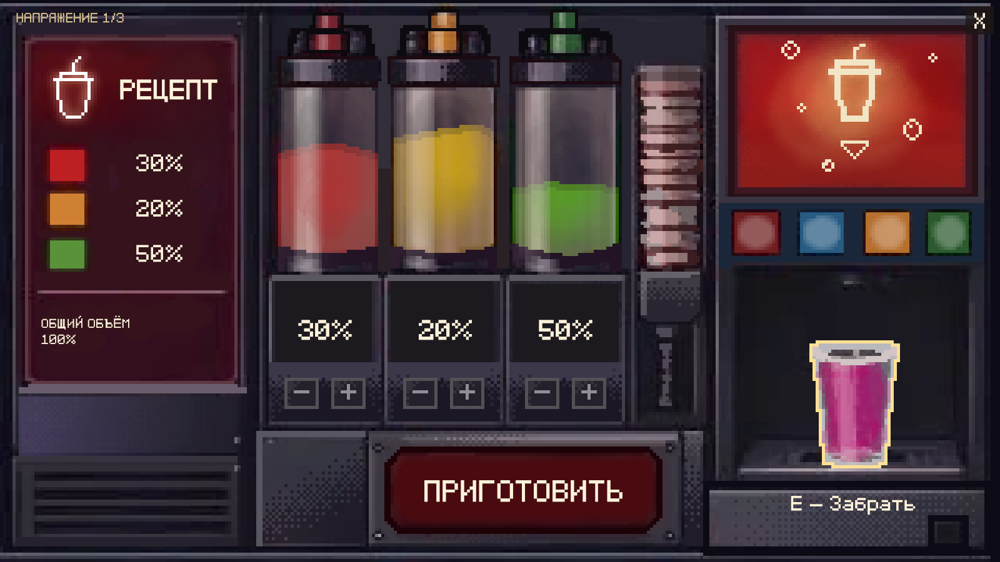

# Крупный план автомата с напитками

В FastFood используется авторский `SourceAssets/Art/FastFood/art/guests/01_faceless_man/03_drink/drink_vending.aseprite` (320×180, 22 кадра по 100 мс). Расположение надписей взято из соседнего `drink_vending.png`. Оба исходника сохранены без изменений.

## Управление

- Шесть отдельных кнопок «−/+» меняют три доли от 0 до 100% с шагом 10%. Удержание начинает повторять изменение через 0.35 с, затем каждые 0.06 с. Все семь авторских кнопок получают тёплую пиксельную обводку при наведении.
- На панели показаны рецепт, выбранные проценты и постоянный общий объём **100%**, независимо от выбора. Надпись общего объёма уменьшена до 18 и вписана внутрь рамки на обоих языках. Рецепт берётся из прежнего `FacelessOrderService.Recipe`: сейчас 30% красного, 20% янтарного, 50% зелёного.
- «Приготовить» проверяет каждую долю. Ошибка показывает только «Неверный рецепт» на 1.8 с; приготовления и расхода сиропов не происходит.
- При обновлении холодильника ошибка рецепта и подсказка получения переведены на общий `SmoothServiceNotice`: вход 0.18 с, выход 0.16 с; смена текста через затухание, пауза фиксирует прозрачность. Старые проверки мгновенного текста/activeSelf уведомлений устарели.
- Правильный рецепт запускает приготовление за 3 с со звуком существующего автомата. Колбы расходуются независимо: после рецепта 30/20/50 в них остаётся 70/80/50%. Наполнение стакана использует все 22 авторских кадра в исходном порядке.
- Только наведение на готовый стакан показывает обводку и «E — Забрать». E вне стакана ничего не выдаёт. Постоянных инструкций в крупном плане нет.
- Получение длится 0.7 с: стакан поднимается к игроку, слегка поворачивается, увеличивается и уходит вниз с затуханием. После завершения один напиток появляется на подносе; ниша остаётся пустой. Иконка и осмотр используют авторский наполненный стакан.
- Кнопка X закрывает окно. Незавершённое приготовление отменяется без расхода и награды; незавершённое получение возвращает стакан в нишу. Выбранные проценты, завершённое приготовление и конечные уровни сохраняются при повторном открытии. Пауза останавливает анимации, звук и управление.

## Устройство

`FastFoodDrinkCloseUp` подключён к существующему `FastFoodServiceView`; выдача остаётся в `FacelessOrderService → FastFoodInventory`. Фритюрница и другие станции используют прежние окна. Положение кухонной точки E, фон, свет, камеры и физика не менялись.

Ссылки на UI, спрайты, звук и длительности доступны в `FacelessService / FastFoodDrinkCloseUp`. `VendingButtonHold` отвечает за удержание и обводку кнопок. `FryerArtScale` сохраняет единые координаты 1280×720 внутри вписываемого изображения 16:9. Надписи используют существующий bitmap-шрифт GNF/Point и `LocalizedDialogueSystem`; добавлены четыре ключа `service_vending_*`, надпись приготовления использует `service_pour`.

Ресурсы лежат в `Assets/Sprites/FastFoodService/DrinkVending/`. Флаконы извлечены из слоёв 4/3/2, кнопки из 7–13, стакан и жидкость из 6/1. Три атласа содержат по 101 состоянию расхода: исходная форма волны сдвигается до нужного уровня и обрезается по исходным границам колбы, без сглаживания. Отдельный атлас сохраняет все 22 кадра ниши. Наполненный стакан выделен по его силуэту, чтобы получение не уносило прямоугольный фрагмент фона и не оставляло нарисованную копию в нише.

`source-layers.json` хранит слои, координаты, длительности и SHA-256 исходников; `.aseprite.bytes` — побайтовая копия. Импорт: Full Rect, Point, без сжатия и mipmaps. Экспортёр — `AgentScripts/PrepareDrinkVendingArt.py`. Однократный настройщик — `AgentScripts/ConfigureDrinkVending.cs`: `Apply` сохраняет открытую FastFood и отказывается создавать дубликат; `RefineButtons` также сохраняет сцену. Для просмотра их запускать не нужно.

## Проверки

Пройдены 65 проверок поведения и 59 проверок настоящего Update, звука, локализации и попадания мышью при 16:9, 4:3 и 21:9. Проверены неверные пропорции при сумме 100%, границы значений, независимые уровни, пауза звука/кадров/получения, повторное открытие, отмена действий, однократная выдача, оба языка и наличие/размеры символов. Проверка настоящего цикла проведена после свежей загрузки сохранённой сцены.

После уточнения пользователя шаг изменён на 10%, общий объём закреплён на 100%, надпись вписана в рамку. Пройдены ещё 30 проверок изменения/границ процентов, правильного и неверного рецепта, постоянного 100% и полного текста RU/EN при трёх пропорциях окна — `Logs/DrinkVendingRefinement/`. Старые ожидания шага 1% и суммирования общего объёма в первых проверках устарели.

Отчёты, снимки и резервные копии — `Logs/DrinkVending/`. При работе использовалась локальная документация установленного Pipeline: `commands/scripts.md`, `commands/capture.md`, `commands/editor-lifecycle-and-observability.md`.
