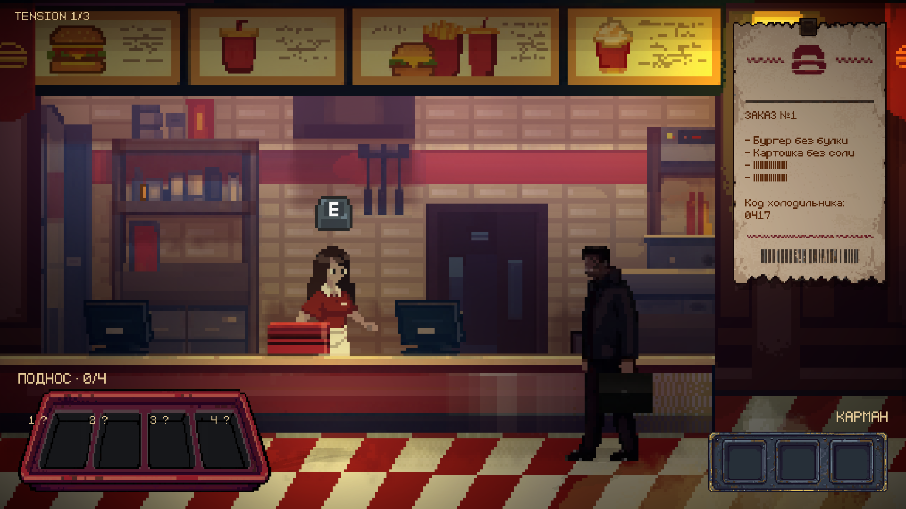

# Обслуживание мужчины без лица — эксперимент PixelLab

Рабочая ветка: `experiment/faceless-pixellab`, создана от `0a21445`. Сцена — `Assets/Scenes/FastFood.unity`; открыть её в Unity и нажать Play. Список сцен сборки и запуск основного меню не менялись.

Реализация с восстановленным исходным чеком и получением заказа у кассы сохранена коммитом в этой ветке по запросу пользователя; push не выполнялся. Игра использует сохранённые ассеты и локальную логику, подключение к PixelLab во время игры не требуется.

Сценарий: внешние `ArtDatabase/FastFood/scenarios/01_faceless_man.pdf` и `docs/eva_inventory.pdf`. Изображения из PDF использованы как референсы PixelLab, а не как готовые игровые картинки. Существующие персонажи, их анимации/голоса, управление Евой, зал и переход на кухню сохранены.

## Игровой цикл

После пробуждения Ева разговаривает с администратором и получает указание встать за кассу. У кассы E запускает прежний TillTrigger: Ева занимает место кассира, администратор повторно подходит и проводит инструктаж, затем приходит мужчина без лица и произносит заказ через существующий GuestOrderSequence. После его реплик, пока Ева ещё за кассой, появляется чек и активируется обслуживание. Следующее E выводит Еву из-за кассы и открывает путь на кухню.

По уточнению пользователя восстановлен исходный чек: оригинальный `Assets/Sprites/Dialog/FastFoodCheque.png`, прежние размеры, пропорции, положение и CanvasDialog. Арт чека не обрезается и не заменяется округлым изображением PixelLab. Сохранены автоматическое уменьшение через 5 секунд и раскрытие при наведении. Код холодильника, отметки собранных вещей и RU/EN продолжают обновляться в тексте чека.

На подносе четыре фиксированных слота: бургер без булки, картошка без соли, напиток без вкуса и игрушка без лица. При выдаче заказа все четыре предмета передаются гостю одновременно. Награда — фрагмент медицинской записи — появляется в кармане и доступна для чтения. Повторный подбор, неполный заказ и повторная выдача награды запрещены.

| Где | Последовательность |
| --- | --- |
| Кухня, фритюрница | E → отключить питание → закрыть крупный план |
| Кухня, та же точка фритюрницы | После отключения питания закрыть крупный план → E → прежний экран предохранителя → извлечь его |
| Фритюрница | E → слить масло, дождаться анимации → взять бургер |
| Холодильник | E → ввести код с чека → дождаться открывания → взять картошку |
| Автомат с напитками | E → авторские кнопки −/+ для трёх долей → приготовить → независимый расход сиропов и наполнение стакана → навести на готовый стакан и E для анимации получения; [подробности](drink-vending.md) |
| Правый конец зала | Пройти в уборную; переход с существующим затемнением |
| Уборная, зеркало | E → посмотреть → дождаться появления игрушки → взять её |
| Мужчина без лица у кассы | E → выдать полный заказ; диалог с прежним голосовым профилем, затем гость уходит |

Управление: A/D — движение, E — ближайшее взаимодействие. Мышь — кнопки, клавиатура/экранная панель — код холодильника, ползунки и кнопки −/+ — сиропы. 1–4 — осмотреть соответствующий собранный предмет; I или клик по карману — прочитать медицинскую запись. Кнопка «Закрыть» возвращает к движению; Esc сохраняет существующее меню паузы.

Кухня обновлена по следующему запросу пользователя: сгенерированный фон и четыре world-объекта заменены исходным Aseprite 700×180. Ближайший нужный слой подсвечивается outline; точки E совпадают с предметами исходного арта. Предохранитель относится к будущему крупному плану фритюрницы, временно его прежний экран открывается на той же точке. Существующие крупные планы и анимации приготовления сохранены. Геометрия, привязка слоёв и настройки — [кухня и outline](kitchen-interaction-outline.md).

Пауза останавливает анимации и звук взаимодействий. Закрытие незаконченного слива, наливания или появления игрушки отменяет действие без выдачи предмета; его можно повторить. Принятый код остаётся действительным при закрытии открывающегося холодильника. Прогресс заказа хранится в пределах текущего запуска FastFood, без новой системы сохранений.

Клоун периодически появляется рядом, говорит короткую подгоняющую фразу и исчезает. Напряжение растёт от 1 до 3, появления учащаются. Это атмосферный индикатор, без таймера проигрыша. При завершённом заказе, паузе и диалогах он не мешает обслуживанию.

## Архитектура

- `SceneIntro → первый разговор с администратором`, затем `TillTrigger → повторный инструктаж → GuestOrderSequence → NpcVisit → DialogPhrases → DialogCanvas/TypewriterText`. Заказ выдаётся после разговора с гостем. Для завершения обслуживания создан второй NpcVisit того же гостя, с прежним профилем голоса и выходом из кадра.
- `FastFoodInventory` хранит четыре позиции подноса и флаг награды; `FacelessOrderService` проверяет зависимости действий и единственную выдачу заказа.
- `FastFoodServiceStation` использует существующий InputService и E, выбирая ближайшую доступную точку. Новые станции не изменяют коллизию игрока.
- `FastFoodServiceView` управляет uGUI инвентарём и крупными планами. Чек и ReceiptHover используют исходный CanvasDialog, исходный спрайт и геометрию. Диалоговые окна персонажей не заменялись. BuildFacelessService больше не перенастраивает чек и не запускает заказ из SceneIntro.
- `FastFoodKitchenRoute` расширен необязательным маршрутом уборной. Уборная расположена около X = −40 в той же сцене. Старое зеркало зала сохранено выключенным; интерактивное зеркало использует новый арт в уборной.
- `FastFoodStationArt` сохраняет внешний вид техники после изменения состояния; `FastFoodTension` управляет клоуном. Тени используют существующие CharacterGroundShadow/CharacterShadowSurface, включая пол уборной.
- У KitchenLampFlicker добавлен необязательный статический фон. В эксперименте используется новый фон PixelLab, существующая последовательность управления шестью Light2D продолжает работать; без override сохраняется прежнее поведение.

## Настройки в Inspector

`FacelessService / FacelessOrderService`: код холодильника (**0417**), рецепт (**30 / 20 / 50%**), ссылки на инвентарь, игрока и существующую цепочку заказа. Код и проценты выводятся из тех же настроек, по которым проверяются ответы. Значения рецепта должны быть целыми от 0 до 100.

`FastFoodInventory`: четыре иконки подноса, иконка награды. `FastFoodServiceView`: длительность действий (**2.4 с**), массивы кадров, арты крупных планов, звуковые клипы и UI-ссылки. `AudioSource` на FacelessService: громкость эффектов (**0.18**). Общая громкость берётся из существующего GameSettings/AudioListener.

`FastFoodServiceStation`: тип точки и дальность взаимодействия. `FastFoodTension`: интервал появления клоуна (**35–55 с**), длительность появления (**4.5 с**). Все рабочие надписи и тексты диалогов находятся в прежней `Assets/Resources/dialogues.json`: ключи `service_*` и `fastfood_*`.

Текст медицинской записи, код 0417 и финальные реплики — авторское заполнение недостающих деталей сценария для эксперимента; их можно менять независимо от логики.

## Генерация и воспроизводимость

Арт — `Assets/Sprites/FastFoodService/`, происхождение и SHA-256 — `generation-manifest.json`. Статические изображения созданы через PixelLab `/v2/generate-image-v2`, анимации — `/v2/animate-with-text-v3`. Последовательности содержат по 9 PNG с исходным и сгенерированными кадрами. Конечные состояния фритюрницы и зеркала уточнены отдельными генерациями и использованы как конечные референсы анимации.

В проекте 56 PNG: 20 статических изображений и четыре последовательности по 9 кадров. Всего выполнены 26 генераций/задач API, использовано **256 генераций подписки** с учётом уточнений. Сеансовый процесс API закрыт, ключ не сохранён. Манифест содержит идентификаторы задач, описания, seed и затраты.

`AgentScripts/PixelLabSession.py` — сеансовый HTTP-клиент: получает ключ через скрытый ввод, хранит только в памяти процесса и не добавляет его в запросы Unity, файлы ресурсов или Git. Параметры генераций и ответы без изображений/секретов находятся в игнорируемой `Logs/FacelessExperiment/`. Для нового подключения потребуется отдельный ввод ключа.

`AgentScripts/BuildFacelessService.cs` создаёт механику в открытой FastFood и сохраняет сцену; Apply отказывается повторно строить существующую группу. RefineArtAndControls предназначен для узкой синхронизации арт-ассетов и UI. Эти методы не следует запускать для простого просмотра: они меняют сцену. `PrepareFacelessServiceText.py` добавляет переводы в существующую JSON-базу.

## Проверки

Полный Play Mode проход сохранён в `Logs/FacelessExperiment/VerifyFacelessService.cs`, отчёт — `verification.txt`. Проверяются автоматический заказ, переходы кухня/зал/уборная, зависимости фритюрницы, неправильный/правильный код, неправильный/правильный рецепт, пауза, отмена незаконченного действия, четыре предмета, RU/EN, вместимость TMP, выдача и однократность награды. Снимки отдельных этапов сохраняются там же. Ранние снимки до исправления размещения фона и чека не описывают окончательный вид.

До уточнения пользователя пройдены **162 проверки полного обслуживания + 33 проверки представления и повторного запуска**. Проверены появления/пауза/локализация клоуна, покрытие камеры новым фоном, настоящие дверные триггеры уборной, кнопки процентов и повторное наливание после отмены. Их ожидания автоматического получения заказа и экранного чека устарели; не менять игру ради этих старых ожиданий. Актуальная проверка начала обслуживания и исходного чека — `Logs/FacelessServiceReview/VerifyOrderFlow.cs`.

После восстановления исходной последовательности пройдены **30 проверок Play Mode**: первый разговор без выдачи заказа, E у кассы, повторный подход и инструктаж администратора, приход/диалог гостя после инструктажа, выдача одного заказа за кассой после его реплик, исходный арт и геометрия чека, RU/EN без переполнения, уменьшение/наведение, выход из-за кассы и доступ к кухне. Консоль без ошибок и предупреждений.

## Снимки

Предыдущие снимки `faceless-service-kitchen.png`, `faceless-service-order-ready.png`, `faceless-service-drink.png` и `faceless-service-medical-record.png` показывают экспериментальную версию до восстановления исходного чека.
