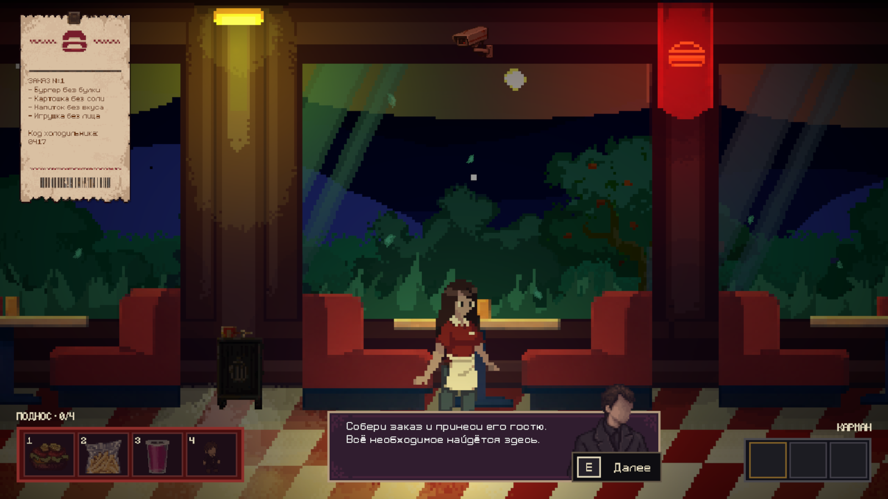

# Интерфейс FastFood

Разметка следует `SourceAssets/Art/FastFood/docs/eva_inventory.pdf`. Чек перенесён влево по отдельному указанию пользователя. Изменения применены к FastFood; общий CAMERA.prefab не менялся.

## Разметка

Опорное разрешение — 1280×720, CanvasScaler Scale With Screen Size, Match 0.5.

| Элемент | Размер | Положение |
| --- | --- | --- |
| Поднос | 328×80 | Слева снизу, отступ 24 |
| Карман | 184×64 | Справа снизу, отступ 24 |
| Чек | 216×366 | Слева сверху, отступы 24/16 |
| Диалог | 480×175.5 | По центру экрана по горизонтали, снизу 24 |
| Подсказка | По содержимому, высота 44 | Общая плашка с отдельной клавишей |

`FastFoodHudLayout` располагает диалоги строго по центру экрана по горизонтали. Авторское окно 640×234 уменьшено до 75% вместе с портретом и текстом; размер регулируется через Dialogue Scale. Проверка доступного места учитывает большую из боковых панелей с отступом: если центрированное окно пересекло бы инвентарь, оно поднимается над ним, нижний отступ 144. При масштабе 75% это происходит при ширине Canvas меньше 1232. Центр окна и положение подсказки продолжения согласованы; асимметричный поднос больше не смещает диалог вправо. Диалоговые Canvas в этой сцене используют Overlay, порядок 50; инвентарь/крупные планы — 40, затемнение маршрута — 100, пауза — 200.

Во время любого крупного плана или осмотра слой диалогов/чека скрывается через общий CanvasGroup с отключением blocksRaycasts/interactable; при закрытии он восстанавливается. У изображений и текста диалогов/записки отключён Raycast Target: даже прозрачный Graphic иначе перехватывает мышь. Чек остаётся единственной интерактивной графикой этого слоя. `ConfigureFastFoodHud.FixModalInput` применяет эти настройки и уменьшение окон к существующей открытой сцене, сохраняя её.

Чек сворачивается до 78% через прежние пять секунд и раскрывается при наведении; левый верхний угол остаётся на месте. Шрифт фиксированный, 14. Названия всех четырёх позиций раскрыты сразу, код холодильника сохранён. На подносе ещё не собранные предметы показаны приглушёнными иконками; осмотр доступен после получения. Готовый поднос получает золотую рамку. Карман сохраняет получение и осмотр медицинской записи.

## Подсказки и уведомления

`FastFoodKeyPrompt` оформляет существующие подсказки кассы/взаимодействия, станций, холодильника, автомата, зеркала, фритюрницы, маршрута на кухню, продолжения диалога и закрытия записки. Источники текста/видимости сохранены, клавиши ввода не менялись. E, A и ЛКМ/LMB используют одну рамку; длинные обозначения расширяют клавишу. Подсказка маршрута скрывается за крупным планом, диалогом, подсказкой станции и паузой.

Верхние всплывающие уведомления убраны по просьбе пользователя. `FastFoodNotificationHub` и `NotificationCard` отключены в сцене; отключённый hub не принимает сообщения. Полученные предметы видны на подносе, готовность обозначается золотой рамкой, награда — в кармане.

Ошибки кода холодильника и рецепта, а также сообщения этапов отображаются внутри соответствующего крупного плана через `SmoothServiceNotice`: плавное появление/затухание, прежние сроки показа, RU/EN и пауза сохранены. Ссылки Notification у этих сообщений сняты. Подсказки клавиш остаются на месте.

## Автоматическое закрытие крупного плана

После полного завершения анимации подбора бургера, картофеля, напитка или игрушки предмет поступает на поднос, затем `FastFoodServiceView` закрывает окно за 0.38 с. Плавная кривая SmoothStep управляет прозрачностью, уменьшением до 96% и сдвигом вниз на 18 пикселей. Длительность задаётся через Completion Close Duration. Ввод остаётся заблокированным до конца перехода; окно перестаёт принимать нажатия и экранирует интерфейс позади себя. Пауза останавливает переход.

Открытие холодильника, слив масла, приготовление напитка и подъём игрушки сами окно не закрывают. Досрочное ручное закрытие отменяет незавершённый подбор. Осмотр предмета в инвентаре и повторное открытие уже выполненной станции остаются открытыми. После закрытия прозрачность и положение сбрасываются для следующего входа. Узкий настройщик `AgentScripts/ConfigureCloseupCompletion.Apply` отключает карточку и возвращает локальные сообщения, сохраняя текущую сцену.

## Настройка и проверки

`AgentScripts/ConfigureFastFoodHud.Apply` — однократная настройка открытой FastFood, сохраняет её вместе с текущими ручными изменениями; повторное применение запрещено. `Refine` уточняет читаемость чека, цвет и значок карточки. Не запускать эти методы для просмотра.

Копии сцены до/после и вспомогательные проверки — `Logs/InventoryUI/`. Проверены видимость/недоступность будущих предметов, получение напитка и игрушки через настоящий hover + E, отмена незавершённой анимации, готовность, карман и осмотр, настоящий неправильный код/рецепт, таймер и пауза, RU/EN, раскрытие и вместимость чека. Прямоугольники диалогов и инвентаря проверены в 1280×720, 1024×768 и 2560×1080. Сохранённая сцена загружена заново, ссылки и отсутствие потерянных скриптов проверены.

Исправления перехвата мыши проверены отдельно в `Logs/InventoryUI/Fixes/`: EventSystem.RaycastAll должен вернуть именно нужную кнопку, затем pointerClick проходит через ExecuteEvents. На трёх форматах экрана проверены все цифры 0–9 и удаление холодильника, шесть регулировок/приготовление напитка, закрытие холодильника, автомата, фритюрницы, зеркала и панели неполного заказа. Проверены восстановление hover чека и уменьшенные окна. Прежняя проверка прямым вызовом действия не обнаруживала перекрывающие raycast-цели и для проверки клика недостаточна.

Проверки нового поведения — `Logs/CloseupCompletion/`: реальные анимации подбора всех четырёх предметов, последовательность выдачи/закрытия/возврата управления, отсутствие повторной выдачи, пауза перехода, отмена подбора, повторный вход и осмотр. Неправильный код/рецепт проверены через EventSystem-клики; локальные ошибки видны, верхняя карточка остаётся выключенной. Сохранённая сцена загружена заново перед проверкой.

Центрирование проверено в текущей пользовательской Play-сессии при 1920×1080 и на изолированных копиях реальных RectTransform при 1280×720, 1024×768, 2560×1080, 1152×720 и 1240×720. Проверены центр каждого окна, отсутствие пересечений с подносом/карманом и размещение в границах экрана. Сессию не останавливали, игровое состояние и разрешение не перенастраивали; сцену не сохраняли. Результаты — `Logs/CenteredDialogue/`.

Старые проверки, ожидающие скрытые иконки/названия, вопросительные знаки, чек справа, постоянную надпись Ready, верхнюю карточку или открытое окно после получения предмета, устарели.
