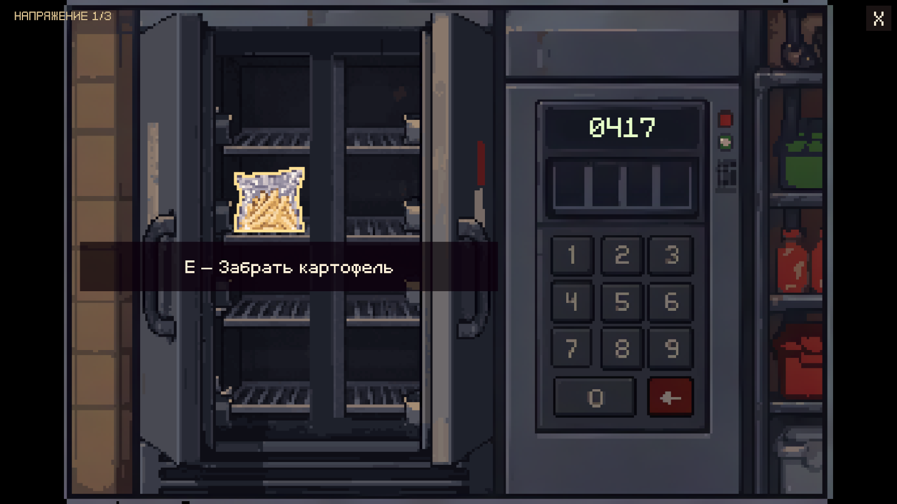

# Крупный план холодильника

В FastFood подключён пользовательский `SourceAssets/Art/FastFood/art/guests/01_faceless_man/02_fries/fridge_keypad.aseprite`: 294×193, 17 кадров по 100 мс. Исходный файл сохранён побайтово.

## Управление

- E у существующей кухонной точки открывает крупный план. Цифры 0–9 и удаление используют 11 отдельных авторских слоёв с тёплой пиксельной обводкой и подсветкой при наведении.
- Код вводится мышью или цифрами клавиатуры/NumPad. Backspace удаляет последнюю цифру, Delete очищает ввод, Enter подтверждает неполный ввод. После четвёртой цифры проверка происходит автоматически: отдельной кнопки подтверждения в исходном рисунке нет. Код остаётся в `FacelessOrderService.FridgeCode`, сейчас **0417**, и виден в прежнем чеке.
- Неверный код очищает ввод и на 2 с показывает локализованное уведомление «Неверный код» с плавным появлением и исчезновением.
- Правильный код проигрывает все 17 авторских кадров открытия за 1.7 с со звуком существующей двери. Разблокировка фиксируется после окончания анимации. Кнопки на время открытия и после разблокировки не принимают ввод.
- Только при наведении на картофель появляются обводка и плавная надпись «E — Забрать картофель». E вне силуэта предмета ничего не выдаёт. Постоянных инструкций нет.
- Получение длится 0.7 с: пакет поднимается, поворачивается, увеличивается и уходит к игроку с затуханием, как стакан напитка. Предмет добавляется на поднос после конца анимации, ровно один раз. Иконка и осмотр используют авторский пакет.
- Пауза фиксирует открытие, звук, получение и прозрачность уведомлений. Закрытие окна во время открытия отменяет незавершённую разблокировку; закрытие во время получения оставляет картофель на полке. Завершённое открытие сохраняется при повторном входе, подобранный пакет больше не появляется.

## Реализация

`FastFoodFridgeCloseUp` подключён к прежнему `FastFoodServiceView`. Проверка/выдача остаются в `FacelessOrderService → FastFoodInventory`. Старый keypad сохранён как резервная реализация, но в этой сцене не показывается. Положение станции E, фон кухни, свет, камеры, физика и код заказа не перенастраивались.

`CloseUpArtScale` вписывает исходные пропорции 294:193 без растягивания и сохраняет систему координат 1176×772. В широком окне по сторонам остаются чёрные поля. UI использует существующие bitmap GNF/Point, EventSystem и GraphicRaycaster. RU/EN — два новых ключа `service_fridge_wrong` и `service_fridge_take` в прежнем `dialogues.json`.

Ресурсы: `Assets/Sprites/FastFoodService/FridgeCloseUp/`. Фон/полки — слои 0/1, картофель — 2, клавиши — 3–13, двери — 14. Скрытые в исходнике слои клавиш включены в отдельные интерактивные объекты. Все 17 кадров дверей сохранены; пакет остаётся отдельным объектом под дверями и переносится в передний план только при получении. Поэтому после подбора на полках не остаётся запечённой копии. Импорт Full Rect, Point, без сжатия/mipmaps, GUID сохранены.

`source-layers.json` содержит исходный SHA-256, размеры, слои, координаты кнопок и длительности. `.aseprite.bytes` — точная исходная копия. `AgentScripts/PrepareFridgeArt.py` использует общий читатель Aseprite из `PrepareDrinkVendingArt.py`, которому добавлен необязательный аргумент пути; экспорт автомата с напитками сохранён. Настройщик `AgentScripts/ConfigureFridgeCloseUp.cs` сохраняет открытую FastFood и отказывается создавать дубликат. `FinishNotices` также сохраняет сцену. Для просмотра их запускать не нужно.

## Плавные уведомления кухни

`SmoothServiceNotice` обслуживает ошибки холодильника и автомата, подсказки получения, сообщения стадий фритюрницы и остальные уведомления `FastFoodServiceView`. Вход занимает 0.18 с, выход — 0.16 с с плавной кривой. При смене текста прежняя надпись сначала затухает, затем появляется новая. Используется игровое время: пауза останавливает переход. Закрытие окна очищает уведомления, чтобы они не переходили в следующий крупный план.

Игровые надписи рецепта, цифры кода, меню и текстовые диалоги персонажей не считаются уведомлениями и продолжают работать через свои прежние механизмы. Прежние проверки, ожидающие мгновенный текст/переключение activeSelf у уведомлений, устарели: теперь видимость определяется CanvasGroup.

## Проверки

Пройдены **68** проверок механики/переходов уведомлений и **60** проверок настоящего Update, аудиосигнала, паузы, RU/EN и raycast всех 11 кнопок при окнах 16:9/4:3/21:9. Последняя группа выполнена после свежей загрузки сохранённой сцены. Проверены ошибка, ведущий ноль, удаление цифр, отмена открытия/получения, однократная выдача, пустые полки после подбора, осмотр предмета, плавность прочих кухонных уведомлений и сохранение шага 10%/постоянного 100% у автомата.

Резервные копии несохранённой сцены, отчёты и снимки — `Logs/FridgeCloseUp/`. Локальная документация Pipeline: `commands/scripts.md`, `commands/capture.md`, `commands/editor-lifecycle-and-observability.md`.
