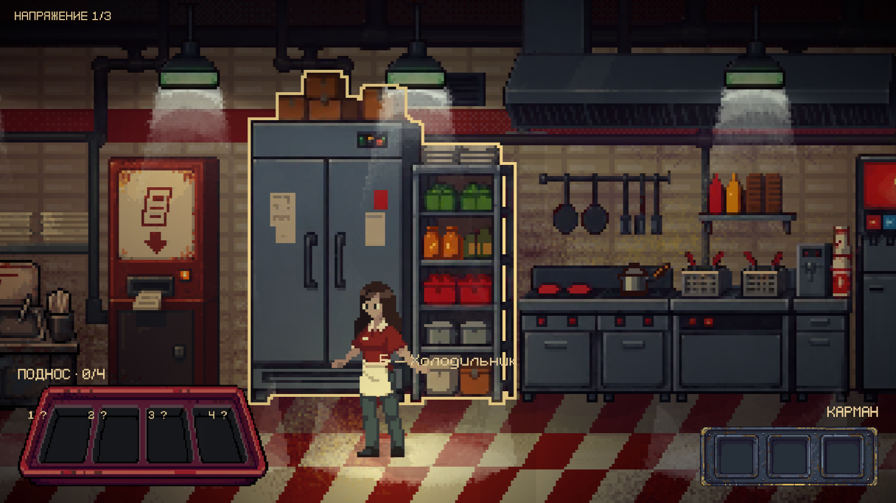

# Кухня Aseprite и выделение предметов

FastFood использует пользовательский `ArtDatabase_Merged/FastFood/art/_shared/bg_kitchen.aseprite`. В проект скопированы исходные байты в `Assets/Sprites/Backgrounds/FastFood/Kitchen/bg_kitchen.aseprite`, GUID сохранён. Кухня 700×180, 100 PPU, Point, масштаб 1. Десять кадров исходной анимации управляются существующим KitchenLampFlicker; его прежний сгенерированный Background Override снят. Положение шести Light2D и их уровни в кадрах взяты из нового слоя ламп `Layer 4.1`.

После проверки пользователь вручную уточнил позиции шести кухонных ламп и настроил Light2D: intensity 1.07, falloff 0.58, inner/outer radius 1.36/2.08, углы примерно 38.29°/92.29°. Эти настройки сохранены вместе с кухней; игровые проверки и снимок ниже сделаны до ручной настройки света.

Сгенерированные объекты `Kitchen/ServiceFryer`, `ServiceFridge`, `ServiceDispenser`, `ServiceFuseBox` удалены из сцены. Прежние крупные планы, анимации слива/открывания/наливания и игровые действия FastFoodServiceView сохранены. Сгенерированные ресурсы остаются в проекте для этих экранов и истории происхождения.

Новая кухня расширена на 2 единицы влево: фон с центром X = −21, границы X = −24.5…−17.5. Пол, левая стена, KitchenConfiner и KitchenShadowFloor расширены соответственно. Правый выход, точка входа, высота камеры и зал сохранены. Существующий материал границ без трения не менялся.

## Слои и взаимодействия

| Слой Aseprite | Взаимодействие | X точки в сцене |
| --- | --- | --- |
| Layer 3 Fries | Фритюрница, питание/слив/бургер | −20.37 |
| Layer 3 Fridge | Холодильник, код/картошка | −21.45 |
| Layer 3 Soda | Автомат напитков, рецепт/наливание | −19.56 |

По уточнению пользователя предохранитель относится к будущему крупному плану фритюрницы. Временно сохранён прежний экран предохранителя, но его точка совпадает с фритюрницей. После отключения питания и закрытия экрана E открывает предохранитель; после его извлечения E снова открывает слив масла/получение бургера. Еве не нужно отходить от фритюрницы.

`FastFoodServiceStation / Only While Task Pending` включён для четырёх кухонных станций. Питание → предохранитель → слив/бургер переключаются последовательно. Холодильник и автомат доступны, пока соответствующий предмет не получен. Остальные станции сохраняют прежнюю доступность. Ближайшая доступная станция по-прежнему выбирается FastFoodServiceView, поэтому E, подсказка и outline относятся к одному предмету.

`Kitchen/Background/InteractionOutlines` содержит четыре SpriteRenderer с FastFoodStationOutline. Две маски одной фритюрницы взаимно исключаются по этапу задачи. Outline показывается только в радиусе взаимодействия у ближайшего нужного предмета; отдаление, пауза, блокировка ввода, смерть, отключение компонента и открытый крупный план убирают его. После сбора предмета выделение и кухонная подсказка этого объекта прекращаются.

## Рендеринг и настройка

`Assets/Shaders/Interaction/LayerOutline.shader` / `.mat` рисуют только внешний контур альфа-маски. Основное изображение остаётся частью исходного фона. Цвет и толщина задаются в материале: светлый тёплый цвет, 1 пиксель исходника по умолчанию. Линия находится в Background/order 1 над фоном и под Евой.

Три PNG в `Kitchen/InteractionMasks/` извлечены из альфы точных слоёв первого кадра с сохранением положения. Края имеют 3 прозрачных пикселя; импорт Full Rect, Point, без сжатия и физического контура. Они не включены в SpriteAtlas. Все десять кадров исходника проверены: слои предметов статичны, меняется освещение. SHA-256 исходника, имена слоёв, прямоугольники и padding находятся в `source-layers.json`. Если предметные слои будут анимированы, понадобятся соответствующие маски кадров.

Однократная миграция — `AgentScripts/ConfigureKitchenOutline.cs`, `Apply(true)`. Она использует текущую открытую FastFood, сохраняет резервную копию с несохранёнными правками, затем сохраняет результат. Повторно для просмотра не запускать: защита проверяет существующую группу. Старый BuildKitchenLampFlicker рассчитан на слои старого 500×180 исходника; для новой кухни не запускать. BuildFacelessService.RefineArtAndControls сохраняет новую кухню при наличии InteractionOutlines.

## Проверки

60 проверок Play Mode: соответствие арта и шейдера, вход/выход, радиус/высота/ближайший предмет, пауза/блокировки/смерть, E и прежние крупные планы, питание/предохранитель/слив/бургер, код/картошка, рецепт/наливание/напиток, исчезновение выделения выполненных действий, десять кадров и Light2D, падение на расширенный пол и сохранение прогресса при переходах. Дополнительно 16 проверок после загрузки сохранённой FastFood с диска. Консоль без ошибок/предупреждений. Копии, отчёты и три снимка — `Logs/KitchenOutline/`.

