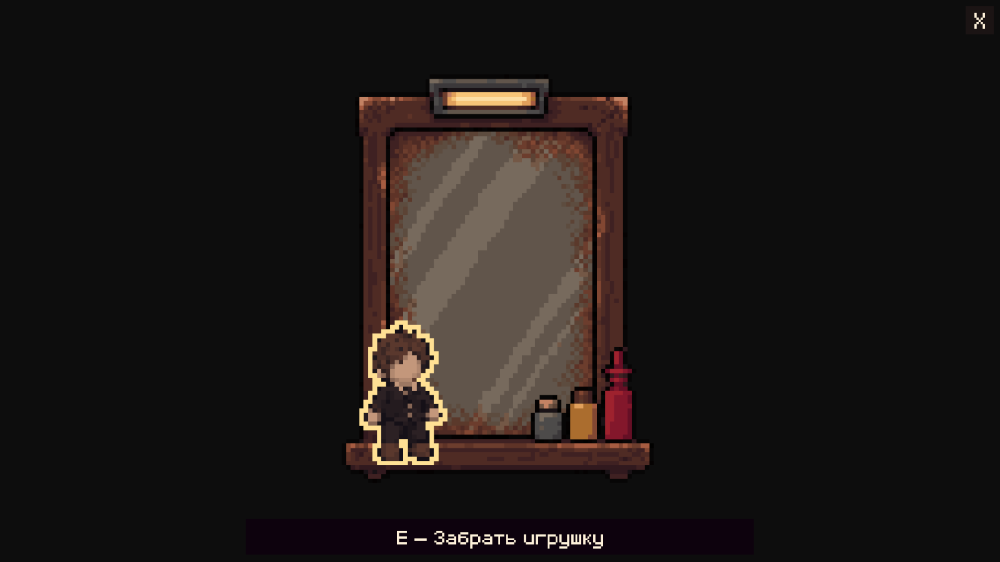

# Зеркало и игрушка без лица

В FastFood зеркало находится в зале между кассой и первым столиком: `TILL/MirrorToy`, позиция `(-5.27, 0.08, 0)`, масштаб 0.8. Оно висит над полом; коллайдеров не добавлено, Ева проходит перед ним. Старое зеркало уборной отключено, прежний декоративный `StoryMirror` остаётся выключенным. Уборная и её переходы сохранены.

По уточнению пользователя игрушка уменьшена вдвое относительно авторского зеркала: стоящая игрушка имеет высоту около 0.25 ед. в зале, примерно треть роста Евы. Уменьшается только слой игрушки, с сохранением точки опоры на полке (42, 106 исходного холста). Используется Nearest без размытия; зеркало, общий crop и его положение не меняются. Масштаб согласован во всех 17 кадрах, обводке, состояниях зала и отдельном спрайте подбора.

## Управление

1. После получения заказа подойти к зеркалу: в радиусе 0.48 появляется outline и обычная подсказка взаимодействия.
2. E открывает ближний вид. Нажатие открытия не запускает следующий шаг в том же кадре.
3. Отдельное E проигрывает все 17 авторских кадров: игрушка встаёт за 1.7 с. Наведение для этого первого шага не требуется.
4. Навести мышь на непрозрачные пиксели стоящей игрушки: появляется обводка и «E — Забрать игрушку».
5. E запускает получение за 0.75 с: игрушка приподнимается, движется по дуге вниз-влево, слегка поворачивается, увеличивается и плавно исчезает. Только после завершения выдаётся один предмет в четвёртый слот подноса и звучит существующий звук подбора.

После получения зеркало остаётся без игрушки и в зале, и в ближнем виде. Повторное E не выдаёт дубликат. Иконка подноса и осмотр предмета используют авторскую стоящую игрушку.

Пауза останавливает кадры, движение, затухание и выдачу. Крестик закрывает окно: незаконченный подъём возвращается к сидячему состоянию; отменённый подбор сохраняет стоящую игрушку. Завершённый подъём сохраняется до конца текущего запуска сцены. Во время крупного плана движение игрока заблокировано; смерть закрывает окно через существующий `FastFoodServiceView`.

## Ресурсы и код

Источник — `SourceAssets/Art/FastFood/art/guests/01_faceless_man/04_toy/mirror_toy.aseprite`, 128×128, 17 кадров по 100 мс. Статический слой `Mirror` и анимированный `Sprite Sheet` экспортированы отдельно без изменения исходника. `AgentScripts/PrepareMirrorToyArt.py` использует существующий Aseprite-читатель; `source-layers.json` хранит SHA-256, слои, длительности и координаты.

Ресурсы в `Assets/Sprites/FastFoodService/MirrorToy/`: зеркало, 17 полных кадров игрушки, обводка, отдельный спрайт подбора, три состояния для зала и копия исходной Aseprite в `.bytes`. Point, Full Rect, без сжатия; текстуры доступны для проверки альфы при наведении. Ближний вид вписывает квадрат 128:128, координаты слоёв совпадают при разных пропорциях экрана.

`FastFoodMirrorCloseUp` работает внутри существующего `FastFoodServiceView`. Прогресс и предметы — прежние `FacelessOrderService.LookInMirror/TakeToy` и `FastFoodInventory`; новой системы заказа нет. Необязательный `FastFoodStationArt._collected` показывает пустое зеркало после получения, а `FastFoodStationOutline._source` синхронизирует силуэт обводки с состоянием зеркала. Остальные станции сохраняют прежнее поведение.

Два новых ключа подсказок RU/EN — `service_mirror_wake_hint` и `service_mirror_take_hint`. Используются существующие `GNF`, `SmoothServiceNotice`, Canvas и EventSystem. Остальные строки локализации сохранены.

Однократный настройщик `AgentScripts/ConfigureMirrorToy.cs`, метод `Apply`, создаёт ближний вид и зеркало, переносит существующую MirrorStation из уборной в зал и назначает иконку предмета. Сохраняет открытую FastFood вместе с ручными правками; отказывается создавать дубликат. Для просмотра или ручной настройки повторно не запускать.

Узкий `ResizeToyPickup` после экспорта уменьшенной игрушки обновляет размер и положение прямоугольника подбора по source-layers.json; сохраняет сцену вместе с ручными правками. Повторно для просмотра не запускать.

## Проверка

Пройдены 59 проверок Play Mode: 17 кадров и время подъёма, радиус/outline, защита E открытия, промежуточные позы в настоящем Update, пауза, отмена обоих действий, повторный вход, наведение по альфе, ровно один предмет, пустое зеркало, осмотр на подносе, RU/EN, 16:9/4:3/21:9 и открытие прежних кухонных окон. Сохранённая сцена отдельно загружена для проверки ссылок контроллера и всех 17 кадров. Консоль без ошибок и предупреждений.

Резервные копии сцены с диска и несохранённого состояния Editor, обзор исходных слоёв, проверки и снимки — `Logs/MirrorToy/`. Относительно текущего снимка Editor изменены 13 прежних блоков сцены и добавлены 54 новых; удалений нет. Порядок прежних блоков восстановлен без изменения значений, ручные настройки сохранены. Play Mode остановлен, Run In Background восстановлен в false, auto-tick остаётся включённым (16 мс).

